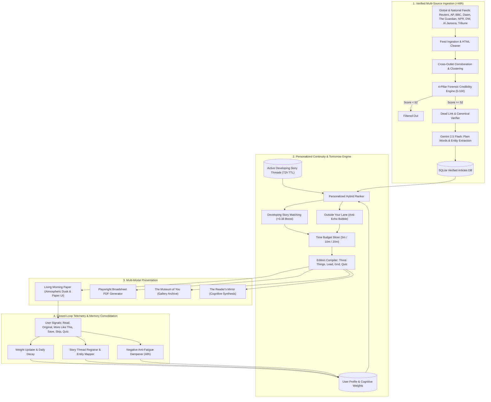

# ZOK (ذوق) 
Your Calm Morning Paper

### *"A feed never ends. A newspaper does."*

---
## The Problem

News today is scattered across dozens of apps. Social media mixes real stories with rage-bait and rumors. Most people scroll for 45 minutes and **still can't name three things they actually learned**.

That's not reading. That's doomscrolling.

## The Solution

**ZOK** is a personal morning newspaper that:

- **Ends.** Every edition has a finish line: 5, 10, or 20 minutes. Then you're done.
- **Checks its sources.** Every story gets a trust score from 0 to 100. Low-quality stuff never reaches you.
- **Gets better over time.** The more you read, the smarter your paper becomes tomorrow.
- **Listen while making your morning tea.** It has a feature, allowing to listen the news while you do your morning duties, with speed options.

When you finish reading, ZOK tells you:
> *"You're completely caught up. That is today's verified world. Go live your day."*

---

## Features

| Feature | What It Does |
| :--- | :--- |
| **Timed Editions** | Pick 5, 10, or 20 minutes. Your paper fits your morning. |
| **Trust Scores** | Every article is scored 0–100 for credibility. Below 52? Filtered out. |
| **Developing Stories** | Mark a story with ★ and ZOK tracks updates for you across days. |
| **The Reader's Mirror** | A reflection of what you read, how you think, and time you've saved. |
| **The Museum of You** | Every finished edition becomes a framed front page in your personal gallery. |
| **Broadsheet PDF** | Download a traditional newspaper PDF, printed from your browser. |
| **Outside Your Lane** | One surprise story from a topic you'd never pick — to pop your bubble. |

---

## How Trust Scoring Works

Every article is checked against **4 pillars** before it can appear in your paper:

| Pillar | Weight | What It Means |
| :--- | :---: | :--- |
| **Publisher Reputation** | 35% | Is the source a known, respected newsroom? Wire services like Reuters and AP score highest. |
| **Cross-Checking** | 30% | Are multiple independent outlets reporting the same thing? More outlets = more confidence. |
| **Evidence & Proof** | 20% | Does the article cite real data, named officials, or documents? Vague "sources say" gets penalized. |
| **Freshness & Transparency** | 15% | Is it recent? Is the author named? Is the link working and secure? |

**Trust badges at a glance:**
-  **Verified Gold** (78+): Multiple outlets confirm, with hard evidence.
-  **Reliable Silver** (64–77): Reputable source with clear attribution.
-  **Developing** (52–63): One source so far, waiting for confirmation.
- Below 52: **Thrown out.** You never see it.

---

## How ZOK Learns

Every time you read, ZOK quietly watches what interests you:

1. **You read a full article** → ZOK bumps that topic's weight up
2. **You click "★ More Like This"** → ZOK tracks that story across days
3. **You skip something** → ZOK gently lowers that topic
4. **You ignore a category for days** → It fades away naturally

There's also a built-in **anti-echo-bubble** feature: ZOK always slips in one story from outside your usual interests, so you stay curious.

---

## Architecture



---

## Run Locally

### 1. Install dependencies
```bash
pip install -r requirements.txt
playwright install chromium
```

### 2. Add your API key
Create a `.env` file:
```env
GEMINI_API_KEY=your_gemini_api_key_here
```

> [!NOTE]
> If you don't have a Gemini key, ZOK still works — it falls back to cleaned feed text and local entity extraction.

### 3. Start the server
```bash
python run.py
```
Open **http://127.0.0.1:8000** in your browser.

---

## Deploy to the Web

See **[DEPLOY.md](DEPLOY.md)** for step-by-step instructions to deploy on Render (free tier).

---

## Tech Stack

| Layer | Technology |
| :--- | :--- |
| Backend | FastAPI + Uvicorn |
| AI | Google Gemini 2.5 Flash |
| Data | SQLite + RSS/Atom feeds |
| PDF | Playwright (headless Chromium) |
| Frontend | Jinja2 templates, vanilla CSS/JS |
| Hosting | Render (free tier) |

---

## Algorithmic & System Efficiency Benchmarks

Performance evaluation conducted using live news feeds, credibility verification, story clustering, and personalized ranking.

| Metric | Result | What It Means |
|----------|----------|----------|
| **Verified Articles Identified** | **264** | Total number of high-credibility articles discovered and validated from aggregated news sources. |
| **Articles Processed** | **241** | Articles successfully ingested, parsed, and included in the recommendation pipeline. |
| **News Sources** | **9 Outlets** | Trusted news organizations continuously monitored for content aggregation. |
| **Multi-Feed Ingestion Time** | **52.8 seconds** | Time required to fetch feeds, validate links, process metadata, and store articles in the local database. |
| **Cross-Outlet Clustering Time** | **61 ms** | Time required to identify and group articles from different publishers covering the same event or topic. |
| **Personalized Ranking Latency** | **47 ms (median)** | Average time required to generate a customized news feed tailored to an individual user's interests. |
| **Best-Case Ranking Latency** | **23 ms** | Fastest recorded personalized feed generation during testing. |
| **Worst-Case Ranking Latency** | **543 ms** | Slowest observed feed-generation time under benchmark conditions. |
| **Database Storage Footprint** | **56 KB** | Total SQLite database size required to store 241 processed articles and related metadata. |

### 🚀 Key Takeaways

- Aggregates news from **9 trusted sources** into a unified feed.
- Processes and validates **241+ articles** per benchmark run.
- Detects duplicate coverage across publishers in just **61 milliseconds**.
- Generates personalized article rankings in **under 50 milliseconds on average**.
- Maintains an extremely small 

---

0 | Portal-grade dawn gradient sky, clean cards, newspaper mascot illustration, expandable "Read more" drawers, and iconic broadsheet PDF layout. |

