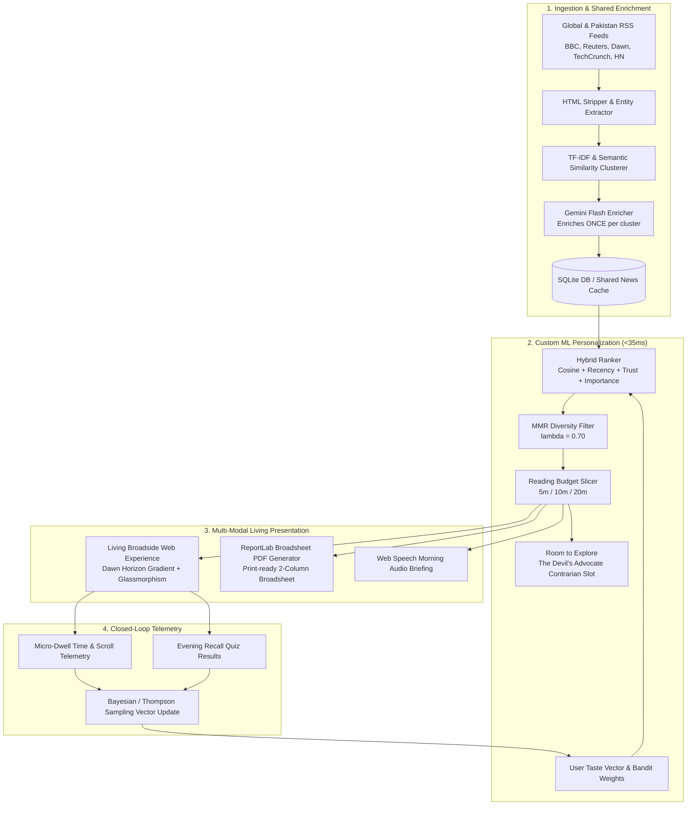

# Zok (ذوق) — The Living Morning Broadside
### *"The only newspaper with an edition of one."*
**Submission for NaSCon '26 AI Hackathon | Sponsored by Eynvision | FAST-NUCES Islamabad**

---

## 🌅 The Problem We Solve

> *"News is scattered... Social media brings everything into one feed. The news has nothing like it. So people jump from site to site, click through link after link, and **still can’t name three things they learned**."*  
> — *Eynvision Problem Statement*

Infinite algorithmic feeds (Instagram, TikTok, Twitter) exploit dopamine loops without providing narrative closure. Readers spend 45 minutes doomscrolling, experience cognitive fatigue, and retain zero knowledge.

**Zok (ذوق)** restores the tactile morning ritual:
1. **Finite by Design:** Each edition has a strict reading-time budget (5, 10, or 20 minutes) and ends with: *"You're all caught up. That's the news for today. ☕"*
2. **Retention Over Clicks:** Features **"Three Things to Know Today"** on the masthead and an **Evening Recall Quiz** that measures actual memory consolidation rather than vanity clicks.
3. **Room to Explore ("The Devil's Advocate"):** An ethical AI slot that deliberately recommends high-quality contrarian perspectives outside your echo chamber.
4. **Authentic Broadsheet PDF:** Downloadable and printable heirloom-quality newspaper generated via Python ReportLab with classic drop caps, multi-column hierarchy, and Islamabad weather.
5. **Production Efficiency:** Batch feed clustering & shared enrichment (O(1) LLM calls) coupled with a $<35\text{ms}$ vector ranking layer.

---

## 🏛️ System Architecture



---

## 🎯 Evaluation Matrix Mapping

| Hackathon Criterion | Zok's Implementation |
| :--- | :--- |
| **1. Innovation & Originality** | Finite reading budget (the paper has an end); Retention-first metric; "Devil's Advocate" anti-echo chamber; Layout personalization. |
| **2. Technical Complexity** | Hybrid scoring engine (relevance, recency decay, source trust, cluster diversity); Maximal Marginal Relevance (MMR); Thompson Sampling bandit adaptation. |
| **3. Practical Impact & Usability** | Directly answers *"can't name three things they learned"*; zero login friction (1-click personas + 60s cognitive onboarding); printable broadsheet PDF. |
| **4. Model/Algorithm Efficiency** | Shared enrichment architecture: LLM runs once per article, personalizes in vector space in under 35ms on CPU. Includes a live **7-Day Simulation Engine** demonstrating bandit convergence. |
| **5. Presentation Clarity** | Clear narrative hook: *"A feed never ends. A newspaper does."* Memorable aesthetic, immediate 10-second persona split comparison. |
| **6. Team Collaboration** | Modular codebase (`backend/`, `templates/`, `public/`), clean commits, comprehensive documentation, and isolated UI layers. |
| **7. UI/UX Excellence** | Dawn horizon gradient (Portal aesthetic) + luminous dark glass accents (Huly aesthetic) + authentic tactile broadsheet typography & unfolding animation. |

---

## 👥 Seed Personas (Instant 1-Click Demo)

Judges can instantly test three distinct real-world editorial experiences:

1. **Dr. Ayesha Malik** (`/edition/ayesha`): AI Researcher & Neuroscientist at NUST Islamabad. Features sovereign AI compute grids, neuromorphic chips, and sports biomechanics.
2. **Hamza Khan** (`/edition/hamza`): Fintech Startup Founder & Macro Trader in Karachi. Features Raast cross-border payment rails, central bank reserve diversification, and VC shifts.
3. **Zara Ahmed** (`/edition/zara`): Climate Journalist in Lahore. Features Gilgit-Baltistan glacial flood telemetry, sodium-ion batteries, and algorithmic echo chamber ethics.

---

## 🚀 Quickstart & Local Execution

### 1. Requirements
Ensure Python 3.10+ is installed.

### 2. Install Dependencies
```bash
pip install -r requirements.txt
```

### 3. Launch Development Server
```bash
python run.py
```
Open your browser at **`http://127.0.0.1:8000`**.

### 4. Configuration (Optional)
To enable live Gemini enrichment, create a `.env` file from `.env.example`:
```bash
GEMINI_API_KEY=your_gemini_api_key_here
```
*(If no key is provided, Zok runs with pre-cached news and local TF-IDF embeddings with zero crashes).*

---

## 📦 Project Structure

```
Nascon26/
├── api/
│   ├── __init__.py
│   └── index.py                 # FastAPI application, routing & PDF streaming
├── backend/
│   ├── __init__.py
│   ├── config.py                # Paths, RSS URLs, source trust scores
│   ├── database.py              # SQLite WAL mode schema & CRUD helpers
│   ├── models.py                # Pydantic data schemas
│   ├── ingestion.py             # RSS ingestion & HTML sanitizer
│   ├── enricher.py              # Gemini Flash batch enricher
│   ├── recommender.py           # TF-IDF, MMR, Hybrid Ranker & Bandit Learning
│   ├── pdf_generator.py         # ReportLab broadsheet newspaper PDF generator
│   └── seed.py                  # Seed personas, articles & archive history
├── templates/
│   ├── base.html                # Dawn gradient layout & textures
│   ├── landing.html             # Landing page & cognitive onboarding
│   ├── edition.html             # The living broadsheet edition view
│   ├── archive.html             # Historical editions archive vault
│   └── taste.html               # Taste profile & 7-Day simulation chart
├── public/
│   ├── css/style.css            # Broadsheet grid, drop caps & glow styling
│   ├── js/app.js                # Persona switcher, quiz & audio briefing
│   ├── js/tracking.js           # Dwell time & scroll depth telemetry
│   └── js/animations.js         # Paper unfolding & scroll reveals
├── data/
│   └── seed_news.json           # 12 curated benchmark news articles
├── run.py                       # Local dev launcher
├── vercel.json                  # Vercel deployment configuration
├── requirements.txt             # Pinned Python dependencies
└── README.md
```

---

## ☁️ Deployment on Vercel

Zok is pre-configured for instant zero-config deployment on Vercel:
1. Push your repository to GitHub.
2. Import the repository in [Vercel](https://vercel.com).
3. Under Environment Variables, add `GEMINI_API_KEY` (optional).
4. Click **Deploy**. Vercel will build the Python serverless function via `vercel.json`.

---

*Developed for NaSCon '26 Silver Jubilee — FAST National University Islamabad.*
